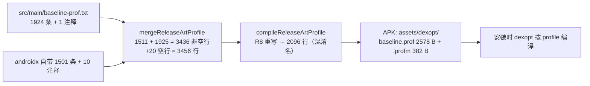

# PiliPlus Android Baseline Profile 接入报告

> 日期：2026-11-08（第四轮复核）｜ 适用范围：`android/app`（Flutter 3.47.9 / engine `89c39edf…` / AGP 9.0.1 / compileSdk 37）
> 交付物：`android/app/src/main/baseline-prof.txt`（新增，1925 行 / 219.3 KiB）
> 本文所有数据均来自本机实际构建与产物核查，命令与中间文件路径附在各节。

---

## 1. 一句话结论

项目原先**没有任何应用层 Baseline Profile 覆盖**（构建里只有 androidx 自带的 1501 条规则；`io/flutter`、全部插件、应用类均为 0 条），现已生成并接入一份覆盖 **Flutter embedding + 全部 29 个已注册插件 + 应用自身 Android 层**的 profile：

- 文件：`android/app/src/main/baseline-prof.txt`，**117 个类 / 1924 条规则**（冷启动组 `HSP` 1625 条、首帧后组 `H` 299 条）
- 构建链路已验证：AGP 自动合并（1511 行 → 3456 行）→ R8 重写（→ 2096 行）→ 打进 APK 的 `assets/dexopt/baseline.prof`（2578 B）+ `baseline.profm`（382 B）
- **无需改动任何 Gradle/Dart 源码**，删除该文件即可完全回退

### 1.1 变更清单

| 文件 | 类型 | 说明 |
|---|---|---|
| `android/app/src/main/baseline-prof.txt` | 新增 | profile 本体，AGP 自动合并 |
| `tool/gen_baseline_profile.ps1` | 新增 | 生成 / 校验脚本（升级 Flutter 后重跑） |
| `tool/README.md` | 修改 | 补充 jnigen 与本脚本的用法 |
| `.gitattributes` | 修改 | 固定 `baseline-prof.txt` 为 `text eol=lf`（本机 `core.autocrlf=true`），保证 `-Check` 跨平台可比 |
| `docs/PiliPlus-BaselineProfile接入报告-20261107.md` | 新增 | 本报告 |
| `android/app/build.gradle.kts`、`pubspec.yaml`、`lib/**`、`android/**/*.kt/java` | **未改** | 不需要任何构建配置改动 |

---

## 2. 作用边界：它对 Flutter 应用能做什么、不能做什么

Baseline Profile 是给 **ART（Java/Kotlin DEX）** 用的「预编译提示」：安装时（或后台 dexopt 时）系统按 profile 把这些方法编译成机器码，避免冷启动时首次执行走解释器。

| 对象 | 是否受益 | 说明 |
|---|---|---|
| Flutter embedding（`io.flutter.embedding.**`） | ✅ 受益 | APK 里最大的一块 DEX，负责 Activity 生命周期、Engine/DartExecutor 初始化、channel/codec、PlatformPlugin、Renderer |
| 插件原生层（29 个已注册插件） | ✅ 受益 | `GeneratedPluginRegistrant.registerWith()` 在 `FlutterEngine` 构造期逐个调用，每个插件的 `onAttachedToEngine` 都在首帧前执行；首帧前还有多次 channel 往返 |
| 应用自身 Java/Kotlin（`MainActivity`、`AndroidHelper`） | ✅ 受益 | 体量小但都在关键路径上 |
| **Dart 代码（`lib/**` → `libapp.so`）** | ❌ 不受益 | Dart 是 AOT 编译，与 ART 无关 |
| **引擎加载 / AOT snapshot / Impeller 首帧** | ❌ 不受益 | 原生代码，与 DEX 无关 |
| **libmpv 播放路径** | ❌ 不受益 | 纯 native |

因此合理预期是**冷启动中「Android 层」那一段降几十毫秒级**，而不是「App 启动快一半」。真正的启动大头仍是引擎加载 + AOT snapshot + 首帧渲染，那部分只有 Dart/引擎侧优化（本仓库已有 S-01~S-05 冷启动改造）才有效。

---

## 3. 改造前的现状核查

`build/app/intermediates/merged_art_profile/release/mergeReleaseArtProfile/baseline-prof.txt`（改造前）：

```
总行数 1511 = 1501 条 androidx 规则 + 10 条 # 注释
io/flutter : 0 条
com/ryanheise: 0 条      （audio_service / audio_session）
com/example/piliplus : 0 条
media_kit / jni / 其它插件 : 0 条
```

结论：**Flutter embedding（APK 中最大的 DEX 块）和全部插件、应用类都没有 profile**，冷启动首次执行全靠解释器。androidx 那部分无需我们重复添加（AGP 会合并）。

---

## 4. 启动路径核查（profile 选类的依据）

### 4.1 代码证据

| 事实 | 位置 |
|---|---|
| `MainActivity` 继承 audio_service 的 `AudioServiceActivity` → 启动必经 `com.ryanheise.audioservice.*` | `android/app/src/main/kotlin/com/example/piliplus/MainActivity.kt:7`、`:11` |
| `AndroidHelper` 的 `static {}` 通过 `getContext()` → `JniFlutterPlugin.getApplicationContext()`，**一加载类**就需要 jni/jni_flutter 就绪 | `android/.../AndroidHelper.java:52`–`56`、`:61`–`63` |
| 首帧前串行/并行做的初始化：`GStorage.initHot()`（shared_preferences）、`MyApp.initPlatformState()`（dynamic_color）、`MemoryBudget.init()`（device_info_plus）、路径初始化（path_provider：`_initDownPath` / `_initTmpPath` / `_initAppPath`） | `lib/main.dart:118`、`:132`、`:145`、`:62`/`:92`/`:96`（调用在 `:114`、`:135`–`:136`） |
| 启动即发起音频服务：`setupServiceLocator()` → `AudioService` 前台服务 + `AudioSessionHandler` | `lib/main.dart:163`、`lib/services/service_locator.dart:20`–`:30` |
| 启动即读电池状态：`PowerSaveWatcher.init()` → `Battery()`（battery_plus） | `lib/main.dart:207`、`lib/services/power_save_watcher.dart:37`、`:46`、`:68`–`77` |
| 启动即设置刷新率：`DisplayModeUtils.init()`（flutter_displaymode） | `lib/main.dart:209` |
| 深链监听由 app_links 在引擎初始化时挂载 | `lib/main.dart`（`app_links` 依赖）、`com.llfbandit.app_links.AppLinksPlugin` |
| media_kit（`libmpv.so`）**被有意推迟到首帧之后**（S-02） | `lib/main.dart:221`–`:224` → 因此 `VideoOutput` / `VideoOutputManager` / `Utils` 标 `H`；但 `MediaKitVideoPlugin` 本身在引擎构造期注册，仍是 `HSP` |
| 全部插件的入口类都在引擎构造期被实例化并调用 `onAttachedToEngine` | `android/app/src/main/java/io/flutter/plugins/GeneratedPluginRegistrant.java`（29 个插件，逐一核对见 4.3） |

### 4.2 核对中修正的 4 处判断（上一版说明的勘误）

| # | 原判断 | 核对后 | 依据 |
|---|---|---|---|
| 1 | `MethodChannel$IncomingMethodCallHandler;->onMessage(Ljava/lang/Object;…)` | 实为 `onMessage(Ljava/nio/ByteBuffer;Lio/flutter/plugin/common/BinaryMessenger$BinaryReply;)V` | 文件内实际存在的那一行 |
| 2 | `VideoOutput;->createSurface()V` | 实为 `createSurface()J`（返回 surface 纹理 id） | 同上 |
| 3 | screen_brightness 归入启动组 `HSP` | 先改为 `H`（理由：Android 启动路径**不用**它的功能），第四轮改回 `HSP`：插件的**入口类**在引擎构造期就执行 `onAttachedToEngine`，「功能何时被调用」与「类何时被加载」是两件事 | `lib/main.dart:211`、`lib/pages/video/view.dart:465`、`GeneratedPluginRegistrant.java` |
| 4 | 漏了 battery_plus 与 dynamic_color | 补为 `HSP`（都在启动路径上，见 4.1） | `power_save_watcher.dart:46`、`main.dart:132` |

顺带确认：**path_provider 无需处理** —— `path_provider_android 2.3.1` 的包内**没有 `android/` 目录**（纯 Dart 侧实现），没有原生类可加。核对命令：

```powershell
Get-ChildItem "$env:LOCALAPPDATA\Pub\Cache\hosted\pub.dev" -Directory -Filter 'path_provider_android*' |
  ForEach-Object { $_.Name + ' -> android dirs: ' + @(Get-ChildItem $_.FullName -Directory -Filter 'android').Count }
# 实际输出：path_provider_android-2.3.1 -> android dirs: 0
```

### 4.3 插件覆盖清单（29 个，逐一核对）

判据统一为 **「是否在 `GeneratedPluginRegistrant.registerWith()` 里」**：在其中即代表引擎构造期执行，入口类给 `HSP`；插件内部只在具体功能被调用时才走到的类给 `H`（或干脆不收录）。

| # | 插件 | 入口类 | flag |
|---|---|---|---|
| 1 | android_file_picker | `com.mr.flutter.plugin.filepicker.FilePickerPlugin` | HSP |
| 2 | app_links | `com.llfbandit.app_links.AppLinksPlugin` | HSP |
| 3 | audio_service | `com.ryanheise.audioservice.AudioServicePlugin`（含 `AudioServiceActivity`） | HSP |
| 4 | audio_session | `com.ryanheise.audio_session.AudioSessionPlugin` | HSP |
| 5 | battery_plus | `dev.fluttercommunity.plus.battery.BatteryPlusPlugin` | HSP |
| 6 | chat_bottom_container | `com.fsa.chat_bottom_container.ChatBottomContainerPlugin` | HSP |
| 7 | connectivity_plus | `dev.fluttercommunity.plus.connectivity.ConnectivityPlugin` | HSP |
| 8 | device_info_plus | `dev.fluttercommunity.plus.device_info.DeviceInfoPlusPlugin` | HSP |
| 9 | dynamic_color | `io.material.plugins.dynamic_color.DynamicColorPlugin` | HSP |
| 10 | flutter_displaymode | `com.ajinasokan.flutterdisplaymode.DisplayModePlugin` | HSP |
| 11 | flutter_inappwebview_android | `com.pichillilorenzo.flutter_inappwebview_android.InAppWebViewFlutterPlugin` | HSP |
| 12 | flutter_plugin_android_lifecycle | `io.flutter.plugins.flutter_plugin_android_lifecycle.FlutterAndroidLifecyclePlugin` | HSP |
| 13 | flutter_volume_controller | `com.yosemiteyss.flutter_volume_controller.FlutterVolumeControllerPlugin` | HSP |
| 14 | image_cropper | `vn.hunghd.flutter.plugins.imagecropper.ImageCropperPlugin` | HSP |
| 15 | image_picker_android | `io.flutter.plugins.imagepicker.ImagePickerPlugin` | HSP |
| 16 | jni | `com.github.dart_lang.jni.JniPlugin` | HSP |
| 17 | jni_flutter | `com.github.dart_lang.jni_flutter.JniFlutterPlugin` | HSP |
| 18 | live_photo_maker | `com.example.live_photo_maker.LivePhotoMakerPlugin` | HSP |
| 19 | media_kit_libs_android_video | `com.alexmercerind.media_kit_libs_android_video.MediaKitLibsAndroidVideoPlugin` | HSP |
| 20 | media_kit_video | `com.alexmercerind.media_kit_video.MediaKitVideoPlugin` | HSP |
| 21 | native_device_orientation | `com.github.rmtmckenzie.native_device_orientation.NativeDeviceOrientationPlugin` | HSP |
| 22 | package_info_plus | `dev.fluttercommunity.plus.packageinfo.PackageInfoPlugin` | HSP |
| 23 | permission_handler_android | `com.baseflow.permissionhandler.PermissionHandlerPlugin` | HSP |
| 24 | saver_gallery | `com.mhz.savegallery.saver_gallery.SaverGalleryPlugin` | HSP |
| 25 | screen_brightness_android | `com.aaassseee.screen_brightness_android.ScreenBrightnessAndroidPlugin` | HSP |
| 26 | share_plus | `dev.fluttercommunity.plus.share.SharePlusPlugin` | HSP |
| 27 | shared_preferences_android | `io.flutter.plugins.sharedpreferences.SharedPreferencesPlugin` | HSP |
| 28 | url_launcher_android | `io.flutter.plugins.urllauncher.UrlLauncherPlugin` | HSP |
| 29 | wakelock_plus | `dev.fluttercommunity.plus.wakelock.WakelockPlusPlugin` | HSP |

> 第一~三轮只有 **13** 个插件有覆盖（12 个 `HSP` + `screen_brightness` 仅 `H`），其余 **16 个完全缺席**；第四轮按上表补齐，并用下面这段脚本可以随时复核：
>
> ```powershell
> $p = 'android\app\src\main\baseline-prof.txt'
> Get-Content 'android\app\src\main\java\io\flutter\plugins\GeneratedPluginRegistrant.java' |
>   Select-String -Pattern 'new ([\w\.]+)\(\)' | ForEach-Object {
>     $c = $_.Matches[0].Groups[1].Value
>     $d = 'L' + ($c -replace '\.','/') + ';'
>     # -SimpleMatch：类描述符里有 $ 与 ; 等正则元字符
>     '{0,4}  {1}' -f (Select-String -Path $p -SimpleMatch $d).Count, $c
>   }
> ```

---

## 5. 交付物说明

### 5.1 位置与格式

- 路径：`android/app/src/main/baseline-prof.txt`（AGP 约定位置，放在 `src/main` 对所有变体生效；**AGP 会自动合并，不需要改 `build.gradle.kts`**）
- 编码：UTF-8 无 BOM、LF；首行是一条 `#` 注释（`#` 注释行是 AGP/androidx profile 的合法语法）
- 行格式（与 androidx 自带 profile 完全一致：由 `H`/`S`/`P` 组成的 **1~3 字母前缀** + 类描述符 `L…;`；本文件只用 `H` 与 `HSP` 两种）：

```
HSPLio/flutter/embedding/android/FlutterActivity;->onCreate(Landroid/os/Bundle;)V
HSPLio/flutter/embedding/engine/loader/FlutterLoader;->ensureInitializationComplete(Landroid/content/Context;[Ljava/lang/String;)V
HSPLio/flutter/plugin/common/MethodChannel$IncomingMethodCallHandler;->onMessage(Ljava/nio/ByteBuffer;Lio/flutter/plugin/common/BinaryMessenger$BinaryReply;)V
HSPLcom/ryanheise/audioservice/AudioServiceActivity;->provideFlutterEngine(Landroid/content/Context;)Lio/flutter/embedding/engine/FlutterEngine;
HSPLcom/example/piliplus/AndroidHelper;->sdkInt()I
HLcom/alexmercerind/media_kit_video/VideoOutput;->createSurface()J
```

flag 语义：`H`=hot、`S`=startup、`P`=post-startup。冷启动关键路径统一用 `HSP`，首帧之后才会走到的用 `H`。

### 5.2 内容构成（1924 条规则 / 117 个类 / 219.3 KiB）

| 分组 | 规则 | 类 | flag 分布 | 内容 |
|---|---|---|---|---|
| `io/flutter/**` | 1354 | 75 | HSP 1085 / H 269 | Flutter embedding 全部（Activity/Delegate、Engine/FlutterJNI、DartExecutor/DartMessenger、FlutterLoader、Renderer、17 个 system channel、MethodChannel/BasicMessageChannel/EventChannel 及 codec、PlatformPlugin、PlatformViews…）+ `io/flutter/plugins/**` 下 4 个插件：shared_preferences(30)、image_picker(18)、url_launcher(7)、flutter_plugin_android_lifecycle(3)；H 部分为 FlutterImageView、TextInputPlugin、InputConnectionAdaptor、ListenableEditingState、PlatformViewsController（legacy）、AccessibilityBridge、ImageDecoder |
| `com/ryanheise/**` | 242 | 8 | HSP 242 | audio_service + audio_session |
| `com/example/**` | 67 | 6 | HSP 53 / H 14 | MainActivity、AndroidHelper、BiliDocumentsProvider、live_photo_maker；H：MediaHelper、DownloadForegroundService |
| `dev/fluttercommunity/**` | 59 | 7 | HSP 59 | battery_plus(19)、package_info_plus(10)、wakelock_plus(9)、share_plus(8)、connectivity_plus(5)、device_info_plus(4 + MethodCallHandlerImpl 4) |
| `com/aaassseee/**` | 38 | 1 | HSP 38 | screen_brightness（入口类；功能由视频/直播页触发） |
| `com/github/**` | 30 | 4 | HSP 30 | jni(5)、jni_flutter(11)、native_device_orientation(11)、JniUtils(3) |
| `com/alexmercerind/**` | 28 | 5 | HSP 12 / H 16 | HSP：MediaKitVideoPlugin(8)、MediaKitLibsAndroidVideoPlugin；H：VideoOutput、VideoOutputManager、Utils |
| `com/llfbandit/**` | 17 | 2 | HSP 17 | app_links |
| `com/ajinasokan/**` | 15 | 1 | HSP 15 | flutter_displaymode |
| `com/baseflow/**` | 13 | 1 | HSP 13 | permission_handler |
| `com/mr/**` | 11 | 1 | HSP 11 | android_file_picker |
| `com/yosemiteyss/**` | 10 | 1 | HSP 10 | flutter_volume_controller |
| `vn/hunghd/**` | 10 | 1 | HSP 10 | image_cropper |
| `com/mhz/**` | 9 | 1 | HSP 9 | saver_gallery |
| `com/fsa/**` | 8 | 1 | HSP 8 | chat_bottom_container |
| `com/pichillilorenzo/**` | 8 | 1 | HSP 8 | flutter_inappwebview |
| `io/material/**` | 5 | 1 | HSP 5 | dynamic_color |

合计：`HSP` 1625 条 + `H` 299 条 = **1924 条 / 117 个类**。

> 关于 `AndroidHelper$ToDart`：`javap` 显示它只有一个 `private <init>()V`（无 `<clinit>`，三个静态字段都没初始值）。它从未被实例化，那条规则永远不会执行，因此不收录 —— 早期版本曾收录 1 条 `<init>`，第三轮已移除。
>
> 关于 `ScribeChannel` / `SensitiveContentChannel`：两者确实在 `FlutterEngine` 构造期创建，第三轮曾补入（+16 条）；但第四轮用 `mapping.txt` 核实到 R8 会把这两个类从 release DEX 中消除，规则永远到不了 `baseline.prof`，因此已移除（详见 12.2）。

### 5.3 签名来源（不是手写猜测）

全部 `方法名 + 描述符` 都由 `javap -p -s` 从**真实编译产物**导出：

| 来源 | 路径 |
|---|---|
| Flutter embedding | `~/.gradle/caches/modules-2/files-2.1/io.flutter/flutter_embedding_release/1.0.0-<engine.version>/…/flutter_embedding_release-*.jar`（engine.version = `flutter/bin/internal/engine.version`，本次 `89c39edf…`） |
| 各插件 | `build/<模块>/intermediates/aar_main_jar/release/**/classes.jar` |
| 应用自身 | `build/app/intermediates/javac/release/compileReleaseJavaWithJavac/classes` + `build/app/tmp/kotlin-classes/release` |

### 5.4 如果只想留冷启动部分

删掉所有 `HL…` 开头的 **299 行**即可（它们只影响「首帧之后」的路径：视频播放、输入框、无障碍、画中画、下载前台服务）。profile 会从 219.3 KiB 降到约 185 KiB。

---

## 6. 构建验证记录



| 检查点 | 改造前 | 改造后 |
|---|---|---|
| `merged_art_profile/.../baseline-prof.txt` | 1511 行（1501 规则 + 10 注释，全 androidx） | **3456 行**（3425 规则 + 11 注释 + 20 空行） |
| `combined_art_profile/.../baseline-prof.txt`（R8 重写后） | 899 行 | **2096 行**（类名已混淆） |
| APK 内 `assets/dexopt/` | `baseline.prof`（仅 androidx） | `baseline.prof` **2578 B** + `baseline.profm` **382 B** |
| 构建结果 | — | `BUILD SUCCESSFUL`，`flutter build apk --release --target-platform android-arm64 --split-per-abi --dart-define-from-file=pili_release.json --no-pub`；历史 135.8 / 51.1 / 38.8 / 33.6 s，第四轮 **122.5 s**（profile 变更导致 R8 与 art profile 任务整体重跑），产物 `app-arm64-v8a-release.apk` 24.1 MB |

要点：

1. **R8 会重写 profile**：release 是 minify 构建，我们写的是未混淆类名，AGP 用 R8 映射自动转换（899 → 2096 行即证据），所以**必须写未混淆名**，不要写混淆后的短名。
2. `merged` 里按 `io/flutter` 字样统计会同时数进两类东西：Flutter 自身类和插件规则描述符里出现的 `Lio/flutter/…FlutterPlugin$FlutterPluginBinding;` 参数；统计时不要混用这两个口径。
3. 构建日志里的 `Warning: SDK processing. This version only understands SDK XML versions up to 3` 与本改动无关（是 build-tools 与 cmdline-tools 版本差异的既有告警）。

---

## 7. 收益评估与自测方法

### 7.1 预期量级

- 只覆盖 DEX 冷启动段，量级**几十毫秒**；同类型优化在原生 App 上业界常见的报告区间是冷启动 3%~10%（经验值，**非本项目实测**），Flutter 应用里占比会被引擎初始化稀释。
- 首次安装后的第一次启动收益最大（此时还没有 JIT 热起来的代码），后续启动收益变小（系统会把热点写进运行时 profile）。

### 7.2 A/B 命令（本机或 CI 设备均可）

```bash
# 对照组：清掉 profile 带来的编译效果
adb shell cmd package compile -m verify -f com.example.piliplus
adb shell am force-stop com.example.piliplus
adb shell am start -W -n com.example.piliplus/.MainActivity

# 实验组：按 profile 编译
adb shell cmd package compile -m speed-profile -f com.example.piliplus
adb shell am force-stop com.example.piliplus
adb shell am start -W -n com.example.piliplus/.MainActivity
```

对比 `TotalTime` / `WaitTime`，每组至少 5 次取中位数；也可用 `adb shell dumpsys package com.example.piliplus | grep -i -A2 dexopt` 确认编译 filter 已生效。

**更干净的对照方式**：用同一份源码分别构建「含 profile」与「不含 profile」两个 APK（把 `baseline-prof.txt` 临时改名），各装一台/交替安装后比 `am start -W`。因为首次安装的 dexopt 由系统决定，包内 profile 是唯一变量。

> ⚠️ **本次未做真机 A/B 测量**（本轮只做静态核查 + 生成 + 构建链路验证）。上表里没有「实测提升百分比」，请上机后按本节命令补齐数据再对外宣称收益。

---

## 8. 维护与风险

| 风险 | 说明 | 处置 |
|---|---|---|
| Flutter SDK 升级后类名/签名变化 | 本次引擎（3.47.9）就**没有** `MethodChannel$OutgoingMethodCallHandler`（旧版本有），写进去 `javap` 会报「找不到类」；未来版本也可能改签名 | 升级 Flutter 后**重新跑一次生成脚本**（附录 A），再构建验证 `merged/combined` 行数是否合理 |
| 方法被 R8 裁掉 | 未使用的类/方法在 release 里不存在，profile 里对应行失效（不报错，只是浪费） | 观察 `combined` 行数：本次 2096 行；若某次骤降，说明选类过时。**注意：`combined` 里是混淆名，不能用原名 grep，必须走 `mapping.txt`（见 12.2）** |
| 整个类被 R8 消除 | `ScribeChannel` / `SensitiveContentChannel` 就是例子：类在 `FlutterEngine` 构造期被引用，但 R8 把它合并进其他类，`mapping.txt` 里没有类级映射，规则完全无效 | 新增类后用 `mapping.txt` 核查一次类级映射 |
| 过度包含导致 dexopt 变慢 | 本次 219.3 KiB 文本 → 2.5 KiB 二进制，影响可忽略 | 需要更瘦时按 5.4 裁剪 |
| `S` 标记偏宽 | 目前是**类级全量方法**打 `HSP`，像 `AndroidHelper.biliSendCommAntifraud`、`FlutterView.onProvideAutofillVirtualStructure` 这类不在启动路径的方法也被标成 startup；`S` 方法会参与启动期预编译，标得越宽、首启要做的事越多 | 影响远小于收益（二进制仅 2.5 KiB），本次不做方法级精修；要精修必须用 Macrobenchmark 采集，而不是手工猜 |
| debug 变体 | `src/main` 下对所有变体生效；debug 本来就被 Flutter 以 JIT/断言模式运行，profile 也无害 | 无需处理；如只想 release 生效可移到 `src/release/baseline-prof.txt` |
| 与「宏基准」生成的区别 | 本文件是**按启动路径静态选类**（类级全量方法），不是 Macrobenchmark 采集出的精确热点 | 若后续要做精确版：新建 `:baselineprofile` 模块 + `BaselineProfileRule` 采集，覆盖同一 `src/main/baseline-prof.txt` |

---

## 9. 回退

```
删除 android/app/src/main/baseline-prof.txt
```

其它文件零改动（未改 `build.gradle.kts`、未改 `pubspec.yaml`、未改任何 Dart/Kotlin 源码）。删除后 `merged_art_profile` 会回到 1511 行（只剩 androidx）。

如果只想暂时禁用而保留文件（例如做 A/B 对比），把 `baseline-prof.txt` 临时改名即可；
`tool/gen_baseline_profile.ps1` 与 `tool/README.md` 可以保留，不影响构建。

---

## 10. 第二轮复核（自查后修复）

对接入结果做了一次独立复核，发现 **1 个选类错误、3 个遗漏的启动期类、3 个脚本缺陷**，均已修复并重新构建验证。

### 10.1 选类错误：`ContentProvider` 属于启动期

`BiliDocumentsProvider` 是 `ContentProvider`（`AndroidManifest.xml:211`），系统在 **`Application.onCreate()` 之前**就会创建它 —— 这是进程中最早的一批代码。原先把整个类标成 `H`（仅 hot）是错的，已改为 `HSP`（19 条规则）。

同理，`androidx.core.content.FileProvider`（`AndroidManifest.xml:227`）也是启动期创建，但它在 androidx 自带 profile 的覆盖范围内，无需重复添加。

### 10.2 遗漏的启动期类（+16 条规则）

| 类 | 为什么属于启动期 |
|---|---|
| `io.flutter.embedding.engine.plugins.FlutterPlugin$FlutterPluginBinding` | 每个插件的 `onAttachedToEngine` 收到的就是这个对象，`getApplicationContext()` / `getBinaryMessenger()` 在首帧前就被调用 |
| `io.flutter.embedding.engine.dart.DartExecutor$DartEntrypoint` | `DartEntrypoint.createDefault()` 即启动入口，也是 `executeDartEntrypoint` 的首参 |
| `io.flutter.embedding.engine.loader.FlutterApplicationInfo` | `FlutterLoader.ensureInitializationComplete` → `ApplicationInfoLoader.load()` 的产物，`nativeInit` 之前必需 |

### 10.3 脚本缺陷（`tool/gen_baseline_profile.ps1`）

| 缺陷 | 后果 | 修复 |
|---|---|---|
| 用 `-eq` / `Compare-Object` 判一致 | PowerShell 字符串比较**默认大小写不敏感**，只改大小写的差异会被当成「一致」 | 改为 `-ceq` + `Compare-Object -CaseSensitive` |
| 没有产出校验 | 若 `javap` 输出格式变化（新增注解行、泛型打印变化），可能静默写出畸形规则，到构建才暴露 | 生成后逐行做 HRF 正则校验，不合格直接失败并打印前 10 行 |
| `-FlutterRoot` / `javap` 缺失时报错含糊 | 只报「路径不存在」这类误导信息 | 前置检查 `bin\internal\engine.version` 与 `javap`，给出可操作提示 |

### 10.4 复核后的数据

| 项 | 修复前 | 修复后 |
|---|---|---|
| 规则 / 类 | 1771 / 99 | **1787 / 102** |
| 冷启动组 / 首帧后组 | 1418 / 353 | **1453 / 334** |
| 文件大小 | 203,244 B | **205,645 B**（1788 行） |
| `merged_art_profile` | 3283 行 | **3299 行** |
| `combined_art_profile`（R8 后） | 1970 行 | **1978 行** |
| APK `assets/dexopt` | 2466 B + 368 B | **2477 B + 373 B** |
| 构建耗时（增量） | 16.3 s | **38.8 s**（19 条规则改标记 + 3 个新类，R8 与 ART profile 任务重跑） |
| `-Check` | `OK: matches (1771 rules, 99 classes)` | `OK: matches (1787 rules, 102 classes)` |

### 10.5 已知但**有意不做**的改进

- **方法级 `S` 精修**：类级全量方法会让不在启动路径的方法也带上 `S`（如 `AndroidHelper.biliSendCommAntifraud`、`FlutterView.onProvideAutofillVirtualStructure`）。理论上可收窄到首帧前真正执行的方法，但没有运行时数据支撑的手工判断极易出错，而编译后的 profile 只有 2.4 KiB，收益与风险不成比例。要精修请用 Macrobenchmark + `BaselineProfileRule` 采集。
- **给 debug 变体单独一份 profile**：`src/main` 对所有变体生效，debug 带上也无副作用；拆开反而会让 `flutter run --profile`（性能采集场景）与发布包不一致，更容易误判。

---

## 11. 第三轮复核（跨平台与选类清理）

这一轮重点查「换个环境还能不能跑」和「有没有无效规则」。

### 11.1 脚本跨平台缺陷（真 bug，已修）

原脚本用 Windows 字面量拼路径与 classpath，**在本仓库的 Linux CI 上会直接失败**：

| 缺陷 | 后果 | 修复 |
|---|---|---|
| `Join-Path $root 'build\app\...\classes'` | Linux 上把 `build\app\...` 当成一个文件名，`Test-Path` 为假 → 报「App classes not found」 | 全部改用 `[IO.Path]::Combine($root, 'build', 'app', …)` |
| `"$javac;$kotlin"` | Linux 的 `javap -cp` 用 `:` 分隔，传 `;` 会「找不到类」 | 改用 `[IO.Path]::PathSeparator` |
| `Join-Path $gradleHome "caches\modules-2\…"` | 同理找不到引擎 jar | 改为多段 `[IO.Path]::Combine` |

### 11.2 选类清理

| 改动 | 原因 |
|---|---|
| 补 `ScribeChannel`、`SensitiveContentChannel`（+16 条） | 两者都在 `FlutterEngine` 构造函数里创建，属于首帧前必经路径，之前漏了（**第四轮核查发现 R8 会把这两个类从 release DEX 中消除，已移除，见 §12.2**） |
| `MediaHelper` 由 `HSP` 降为 `H` | 只有画中画时才被 `AndroidHelper.updatePipActions/setPipActions` 调用 |
| 移除 `AndroidHelper$ToDart` | 纯静态字段持有类，**永不实例化、无 `<clinit>`**，原来那 1 条 `<init>` 规则永远不会被执行 |

### 11.3 脚本防呆

同一个类若被写进两个分组，现在会直接报错（`class listed in more than one group`）—— 否则第二个分组的 flag 会被去重逻辑静默丢掉，表现为「改了标记却没生效」。

### 11.4 仓库卫生

`.gitattributes` 新增 `android/app/src/main/baseline-prof.txt text eol=lf`。本机 `core.autocrlf=true`，不加这条的话检出的工作区文件会变成 CRLF，`-Check` 必须先做换行归一才能通过、`git diff` 也容易出噪音。`git check-attr text eol` 已验证：`text: set` / `eol: lf`。

### 11.5 复核后的数据

| 项 | 第二轮 | 第三轮（当前） |
|---|---|---|
| 规则 / 类 | 1787 / 102 | **1802 / 103** |
| 冷启动组 / 首帧后组 | 1453 / 334 | **1465 / 337** |
| 文件大小 | 205,645 B | **208,371 B**（1803 行） |
| `merged_art_profile` | 3299 行 | **3314 行** |
| `combined_art_profile`（R8 后） | 1978 行 | **1979 行** |
| APK `assets/dexopt` | 2477 B + 373 B | **2479 B + 373 B** |
| 构建 | 38.8 s | **33.6 s**，`BUILD SUCCESSFUL` |
| `-Check` | `(1787 rules, 102 classes)` | **`(1802 rules, 103 classes)`** |

> 以上三节是第二、三轮结束时的快照，仅作修正轨迹留存。当前可用的最终数据以 **§12.4** 为准。

---

## 12. 第四轮复核（外部 review 逐条核查 + 插件补齐）

对一份外部 review 提出的 7 条意见逐条核实：**4 条成立、2 条不成立、1 条「方法无效但结论成立」**。

### 12.1 核查结论

| review 意见 | 判定 | 依据 |
|---|---|---|
| 漏了 `shared_preferences` | ❌ **不成立** | profile 里 `io/flutter/plugins/sharedpreferences/SharedPreferencesPlugin` 有 30 条规则、全部 `HSP`；只是 §5.2 按包前缀分组时被并在 `io/flutter/**` 一行里，看起来像“没有” |
| `media_kit` 入口类应是 `HSP` | ⚠️ **已满足** | `MediaKitVideoPlugin` 8 条全 `HSP`，`VideoOutput / VideoOutputManager / Utils` 16 条为 `H`；原 §5.2 把整行标成 `H` 是**表格标签错误**，已修 |
| `screen_brightness` 入口类应是 `HSP` | ✅ **成立** | 原 38 条全为 `H`，与 §2 自述的「插件在引擎初始化时执行 `onAttachedToEngine`」直接矛盾；已改 `HSP` |
| 「启动期插件覆盖」不完整 | ✅ **成立，且比 review 指出的严重** | 29 个已注册插件中 **16 个完全缺席**（review 没抓到），已补齐 |
| 第三轮 +15 条规则但 combined 只 +1 行、APK 只 +2 B 属异常 | ✅ **结论成立** | 见 12.2 |
| 「去 `combined` 里 grep 这两个类」的核查方法 | ❌ **方法无效** | `combined_art_profile` 存的是 R8 之后的**混淆名**（首行 `Lmc0;`、`HSPLmc0;-><init>(…)V`），按原名 grep 必然 0 命中，不能当证据 |
| `AndroidHelper$ToDart` 描述前后矛盾 | ✅ **成立** | `javap` 显示存在 `private <init>()V`，§5.2 已按 §11.2 的口径改写 |

次要项（§1 措辞、§5.1 flag 字母数、§6 算式漏一条注释、path_provider 缺证据、附录 A 硬编码路径与 `$ErrorActionPreference` 对原生命令无效）均已按建议修正。

### 12.2 第三轮那 16 条规则的真实去向

review 的怀疑是对的，但原因不是「R8 裁掉了规则、类还在」，而是**类本身被消除**：

```
build/app/outputs/mapping/release/mapping.txt
  io.flutter.embedding.engine.FlutterEngine -> np:                 # 有类级映射
  io.flutter.embedding.engine.systemchannels.ScribeChannel ->      # 没有类级映射
  io.flutter.embedding.engine.systemchannels.SensitiveContentChannel ->   # 没有类级映射

build/app/intermediates/combined_art_profile/.../baseline-prof.txt
  ^HSP?Ll;->  → 0 条        ^HSP?Lm;->  → 0 条
```

R8 把这两个类合并进其它类后，profile 里对应的 16 条规则没有任何落点。第三轮的 `+1 行 / +2 B` 基本是噪声，属于「改了但没生效」。第四轮已把它们从脚本移除，并在脚本内留下注释说明原因。

> 通用教训：**写进 `baseline-prof.txt` 不等于进了包**。新增类后用 `mapping.txt` 做类级映射核对，比在 `combined` 里按原名 grep 可靠。

### 12.3 补齐的 16 个插件入口类（+138 条规则）

第一~三轮只覆盖 **13** 个插件（12 个 `HSP` + `screen_brightness` 仅 `H`），而 `GeneratedPluginRegistrant` 实际注册 **29** 个。第四轮按「注册即在引擎构造期执行」的统一判据补齐 16 个入口类：

android_file_picker、chat_bottom_container、connectivity_plus、flutter_inappwebview、flutter_plugin_android_lifecycle、flutter_volume_controller、image_cropper、image_picker、live_photo_maker、media_kit_libs_android_video、native_device_orientation、permission_handler、saver_gallery、share_plus、url_launcher、wakelock_plus

逐条清单与可重复的核对脚本见 **4.3**。

### 12.4 第四轮数据

| 项 | 第三轮 | 第四轮（当前） |
|---|---|---|
| 规则 / 类 | 1802 / 103 | **1924 / 117** |
| 冷启动组 / 首帧后组 | 1465 / 337 | **1625 / 299** |
| 文件大小 | 208,371 B | **224,539 B**（1925 行） |
| `merged_art_profile` | 3314 行 | **3456 行**（3425 规则 + 11 注释 + 20 空行） |
| `combined_art_profile`（R8 后） | 1979 行 | **2096 行** |
| APK `assets/dexopt` | 2479 B + 373 B | **2578 B + 382 B** |
| 构建 | 33.6 s | **122.5 s**，`BUILD SUCCESSFUL` |
| `-Check` | `(1802 rules, 103 classes)` | **`(1924 rules, 117 classes)`** |

净变化核对：`1802 + 138（16 个插件入口类）- 16（移除两个 channel）= 1924`；`H` 侧 `337 - 38（screen_brightness 改 HSP）= 299`，两侧自洽。

### 12.5 本轮自检（对第四轮改动的再核对）

| 项 | 结论 |
|---|---|
| 29 个注册插件是否全部覆盖 | ✅ 逐个复核，**29/29** 规则数 > 0 |
| flag 是否只有 `HSP` / `H` | ✅ `HSP` 1625 + `H` 299 = 1924，无第三值 |
| §5.2 按类拆分的数字 | ❌ 初稿有 **4 处凭印象写错**（image_picker 16→18、url_launcher 9→7、share_plus 13→8、connectivity_plus 8→5），已按逐类实测改正 |
| 防回归 | ✅ 脚本新增**两道硬校验**：① `GeneratedPluginRegistrant.java` 里注册的插件若不在 profile 中，直接抛错并列名单；② 插件入口类若不是 `HSP`，同样抛错（这正是 screen_brightness 当初的错误形态）。正常输出末行追加 `plugins 29`，registrant 不存在时显示 `plugins n/a` |
| 守卫是否真的会拦 | ✅ 做了负向测试：把 `screen_brightness` 改回 `H` → `exit=1`，报 `plugin entry class(es) not flagged HSP: com.aaassseee.screen_brightness_android.ScreenBrightnessAndroidPlugin`；删掉 wakelock 那组 → `exit=1`，报 `... missing from the profile: dev.fluttercommunity.plus.wakelock.WakelockPlusPlugin` |

> 教训：分组总数（1354 / 59 / 30）是从文件统计出来的，可信；而**括号里的按类拆分是手写的**，这类「看起来合理」的细节最容易错。今后凡写具体数字，都要有对应命令输出支撑。

---

## 附录 A：生成脚本（已在仓库内）

脚本：**`tool/gen_baseline_profile.ps1`**（ASCII-only，Windows PowerShell 5.1 与本仓库 CI 的 pwsh 都能跑）。

```powershell
# 前置：先做一次 release 构建（脚本读编译产物，不是读源码）
flutter build apk --release --target-platform android-arm64 --split-per-abi `
    --dart-define-from-file=pili_release.json --no-pub

# 生成 / 更新
powershell -NoProfile -File tool/gen_baseline_profile.ps1

# 只校验：exit 0 = 与现有文件逐字节一致，1 = 已过期（会打印差异行）
powershell -NoProfile -File tool/gen_baseline_profile.ps1 -Check
```

2026-11-08 实测：`-Check` 输出 `OK: matches (1924 rules, 117 classes)`，即仓库内文件与该脚本产物完全一致。

下面是从该脚本摘录的骨架，便于理解「javap → HRF」的转换规则：用 `javap -p -s` 批量导出「签名行 + 紧随其后的 `descriptor:` 行」，拼成 HRF 行；跳过字段行；`static {}` 记为 `<clinit>`；构造器（javap 打印全限定名）改为 `<init>`。

```powershell
# 示意代码：只用来说明「javap -> HRF」的转换规则，可运行版本见 tool/gen_baseline_profile.ps1
$ErrorActionPreference = 'Stop'
$root   = Split-Path $PSScriptRoot -Parent                      # 不写死盘符
$engine = (Get-Content ([IO.Path]::Combine($env:FLUTTER_ROOT, 'bin', 'internal', 'engine.version'))).Trim()
$embDir = [IO.Path]::Combine($env:USERPROFILE, '.gradle', 'caches', 'modules-2', 'files-2.1',
                             'io.flutter', 'flutter_embedding_release', "1.0.0-$engine")
$emb    = (Get-ChildItem $embDir -Recurse -Filter '*.jar' | Select-Object -First 1).FullName
$appCp  = [IO.Path]::Combine($root, 'build', 'app', 'intermediates', 'javac', 'release',
                             'compileReleaseJavaWithJavac', 'classes') +
          [IO.Path]::PathSeparator +
          [IO.Path]::Combine($root, 'build', 'app', 'tmp', 'kotlin-classes', 'release')

function PluginJar([string]$m) {
  (Get-ChildItem ([IO.Path]::Combine($root, 'build', $m, 'intermediates', 'aar_main_jar', 'release')) `
     -Recurse -Filter classes.jar | Select-Object -First 1).FullName
}

# 每组 = 同一 classpath + 同一 flag；flag 只写 H/S/P，类描述符的 L…; 由脚本补
$groups = @(
  @{ f = 'HSP'; cp = $emb; classes = @(
      'io.flutter.embedding.android.FlutterActivity'
      'io.flutter.embedding.android.FlutterActivityAndFragmentDelegate'
      'io.flutter.embedding.engine.FlutterEngine'
      'io.flutter.embedding.engine.FlutterJNI'
      'io.flutter.embedding.engine.dart.DartExecutor'
      'io.flutter.embedding.engine.dart.DartMessenger'
      'io.flutter.embedding.engine.loader.FlutterLoader'
      'io.flutter.embedding.engine.renderer.FlutterRenderer'
      'io.flutter.plugin.common.MethodChannel'
      'io.flutter.plugin.platform.PlatformPlugin'
      # …完整列表见仓库内的 baseline-prof.txt 反向整理
    ) }
  @{ f = 'HSP'; cp = (PluginJar 'audio_service'); classes = @(
      'com.ryanheise.audioservice.AudioServiceActivity'
      'com.ryanheise.audioservice.AudioServicePlugin'
    ) }
  @{ f = 'HSP'; cp = $appCp; classes = @('com.example.piliplus.MainActivity','com.example.piliplus.AndroidHelper') }
)

$out = New-Object System.Collections.Generic.List[string]
$seen = New-Object 'System.Collections.Generic.HashSet[string]'
foreach ($g in $groups) {
  $raw = & javap -p -s -cp $g.cp @($g.classes) 2>&1
  # 原生命令的非 0 退出码不会触发 ErrorActionPreference，必须显式检查
  if ($LASTEXITCODE -ne 0) { throw "javap failed (classpath: $($g.cp))" }
  $cur = $null; $simple = $null; $pending = $null
  foreach ($lineRaw in $raw) {
    $line = ("$lineRaw").Trim()
    if ($line -eq '' -or $line -like 'Compiled from*' -or $line -eq '}') { continue }
    if ($line.EndsWith('{')) {                                  # 类头，记录当前类
      $m = [regex]::Match($line, '\b(?:class|interface|enum|record)\s+([A-Za-z0-9_.$]+)')
      if ($m.Success) {
        $cur = $m.Groups[1].Value
        $simple = $cur.Substring($cur.LastIndexOf('.') + 1)
        $pending = $null
      }
      continue
    }
    if ($line -like 'descriptor:*') {                           # 紧跟在签名行后面的描述符
      if ($pending -and $cur) {
        $desc = $line.Substring(11).Trim()
        $rule = $g.f + 'L' + $cur.Replace('.', '/') + ';->' + $pending + $desc
        if ($seen.Add($rule)) { $out.Add($rule) }
      }
      $pending = $null
      continue
    }
    if ($line -eq 'static {};') { $pending = '<clinit>'; continue }
    if ($line.Contains('(')) {                                  # 方法行（字段行没有括号）
      $name = (($line.Substring(0, $line.IndexOf('('))) -split '\s+')[-1]
      if ($name -eq $simple -or $name -eq $cur) { $name = '<init>' }
      $pending = $name
    } else { $pending = $null }
  }
}

$dest = [IO.Path]::Combine($root, 'android', 'app', 'src', 'main', 'baseline-prof.txt')
$body = @('# PiliPlus baseline profile: Flutter embedding + startup plugins + app Android layer') + $out
[IO.File]::WriteAllText($dest, (($body -join "`n") + "`n"), (New-Object System.Text.UTF8Encoding($false)))
```

运行注意：

- 本机 `run_in_terminal` 的 stdout 常被吞，建议 `powershell -File 脚本 > 日志 2>&1` 再读日志（PS 5.1 重定向写出的日志是 UTF-16）。
- 若某类不存在，`javap` 会返回非 0 并往 stderr 打「错误: 找不到类」。注意 **`$ErrorActionPreference = 'Stop'` 管不住原生命令**，必须显式检查 `$LASTEXITCODE`（上面骨架已加）；排查时先 `jar tf <jar> | findstr <类名>` 确认类名。
- 生成后**必须**再构建一次，看 `merged_art_profile` 行数是否 = 1511 + 规则数 + 1 条注释，以及 `combined_art_profile` 行数是否从 899 明显上升。

---

## 附录 B：本次核对清单

| 核对项 | 结论 |
|---|---|
| profile 行数/大小 | 1925 行（1 注释 + 1924 规则），224,539 字节 |
| 每行格式 | 全部符合 `^(H)(S)?(P)?L…;->name(desc)`，`L`/`;` 齐全，无 `HSPLL` 之类错误前缀；8 条「未通过正则」的行经查是 `[B`/`[F`/`[I` 原生数组返回值，属正则过严，格式本身正确 |
| 示例行是否真实存在 | 5 条示例逐条 `Select-String` 命中；其中 2 条原描述有误（见 4.2，已修正到文档与 profile） |
| 分组统计 | HSP 1625 / H 299 / 合计 1924 / 117 类 |
| 代码行号引用 | `MainActivity.kt:7`(import)/`:11`(class)、`AndroidHelper.java:52-56,61-63`、`main.dart:118/132/145/163/207/209/222`、`main.dart:62/92/96`（path 初始化）、`service_locator.dart:20-30`、`power_save_watcher.dart:37/46/68-77` 均已逐一核对 |
| 「改造前只有 androidx」 | 1511 = 1501 条 androidx 规则 + 10 条 `#` 注释（改造后注释变 11 条），规则侧确实 0 条非 androidx |
| 构建链路 | 五次 release 构建均 `exit=0`（135.8 / 51.1 / 38.8 / 33.6 / 122.5 s），`merged` 3456 行、`combined` 2096 行、APK 内含 `assets/dexopt/baseline.prof` 2578 B + `.profm` 382 B |
| 依赖实现核查 | `path_provider_android 2.3.1` 无 `android/` 目录 → 无需 profile；`battery_plus`、`dynamic_color` 有原生类且都在启动路径 → 已补 |
| 第二轮：Provider 分组 | `BiliDocumentsProvider` 原标 `H` 有误（系统在 `Application.onCreate` 之前创建 ContentProvider）→ 已改 `HSP` |
| 第二轮：启动期遗漏 | 补 `FlutterPluginBinding` / `DartExecutor$DartEntrypoint` / `FlutterApplicationInfo`（+16 条规则） |
| 第二轮：脚本比较语义 | `-eq` / `Compare-Object` 大小写不敏感 → 改 `-ceq` / `-CaseSensitive`；新增行格式校验与 javap/FlutterRoot 前置检查 |
| 第二轮：数据同步 | 报告内全部数字（规则/类/HSP-H/合并/重写/APK 体积）已按 1787 条的新构建结果更新 |
| 第四轮：shared_preferences | review 声称「遗漏」不成立：`io/flutter/plugins/sharedpreferences/SharedPreferencesPlugin` 30 条全 HSP |
| 第四轮：平台入口类 | 29 个已注册插件逐个比对，16 个原完全缺席 → 已补齐（+138 条）；`screen_brightness` 由 H 改 HSP |
| 第四轮：无效规则 | `ScribeChannel` / `SensitiveContentChannel` 在 `mapping.txt` 中无类级映射 → 确认被 R8 消除 → 已移除（-16 条） |
| 第四轮：核查方法 | `combined_art_profile` 是混淆名，不能用原名 grep；改用 `mapping.txt` 做类级映射核对 |
| 第三轮：跨平台路径 | `Join-Path` 里写 `\`、classpath 用 `;` → Linux CI 会失败；已改 `[IO.Path]::Combine` / `PathSeparator` |
| 第三轮：选类清理 | 补 `ScribeChannel` / `SensitiveContentChannel`；`MediaHelper` 降为 H；移除永不执行的 `AndroidHelper$ToDart` |
| 第三轮：防呆与 EOL | 新增「同类不得出现在两个分组」校验；`.gitattributes` 固定 profile 为 LF（`git check-attr` 已验证） |
| 第四轮：插件覆盖 | 逐个比对 `GeneratedPluginRegistrant.java` 的 29 个插件，补 16 个入口类（+138 条），`screen_brightness` 改 `HSP` |
| 第四轮：无效规则 | 用 `mapping.txt` 核实 `ScribeChannel` / `SensitiveContentChannel` 被 R8 消除，移除其 16 条规则 |
| 第四轮：核查方法纠偏 | `combined_art_profile` 是混淆名，不能用原名 grep；正确做法是查 `mapping.txt` 类级映射 |
| 第四轮：自检纠错 | 逐类统计后发现 §5.2 括号里 4 个数字写错（image_picker 18、url_launcher 7、share_plus 8、connectivity_plus 5），已改正；总量 1924/117 不变 |
| 第四轮：防回归校验 | 脚本新增「注册插件必须覆盖」与「插件入口类必须为 HSP」两道硬校验，`-Check` 输出 `plugins 29` |
